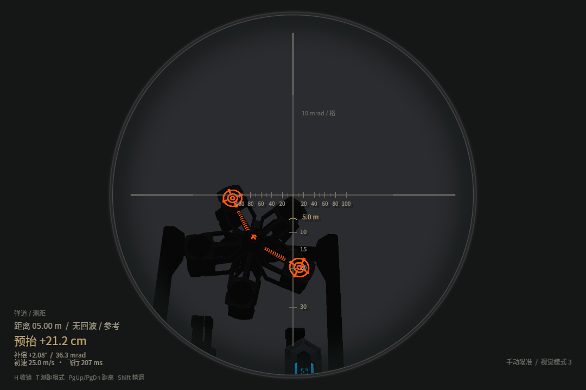
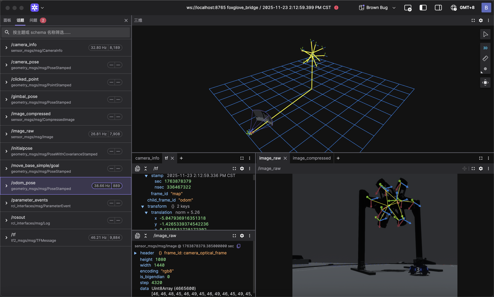

<div align="center">

# 🧪 Daedalus

**RoboMaster 视觉算法验证模拟器**

*为算法而生的实验场，让自瞄在上场前就经历真实考验*

[](https://www.rust-lang.org/)
[](https://bevyengine.org/)
[](https://www.ros.org/)

</div>

## 🚀 功能亮点

* 🎯 **全要素战场环境仿真**
  覆盖能量机关、前哨站、大/小装甲模块等 RoboMaster 核心视觉目标，提供高保真的外观与状态模拟。

* 🤖 **多机器人模型与行为**
  支持步兵（Infantry）与英雄（Hero）机器人的移动、底盘旋转、云台控制与弹丸发射。

* 🔄 **算法-数据-控制完整闭环**
  原生打通 **图像采集 → 目标标注 → ROS2/Talos 推理 → 云台反馈**，实现“看-算-打”全流程验证。

* ⚔️ **多主体动态对抗模拟**
  己方与多个假人独立控制，支持 Tab 键实时切换，真实构造遮挡、对抗与复杂战场场景。

* 🚀 **双通道实时通信接口**
    - **ROS2 原生集成**：直接发布图像、TF 与位姿话题，零成本接入现有自瞄系统
    - **Talos 零拷贝 IPC**：与 [talos](https://github.com/Blackjack200/talos) 通过共享内存通信，支持实时姿势发布与云台命令订阅

* ⚡️ **高性能实时渲染管线**
  基于 Bevy 引擎，支持 CPU/GPU 渲染，保证高帧率与严格的时间一致性。

---

## 🎨 功能覆盖与开发路线

### ✅ 已实现

#### 🏟️ 战场环境仿真

* **能量机关完整仿真** - 大/小能量机关的激活流程与视觉状态模拟
* **前哨站完整仿真** - 前哨站外观与装甲模块状态模拟
* **装甲模块建模与渲染** - 大、小装甲模块全部图案双色灯条显示

#### 🤖 机器人模型与行为

* **步兵机器人（Infantry）** - 移动、底盘旋转、云台控制、17mm弹丸发射
* **英雄机器人（Hero）** - 大装甲模块专属配置、移动与发射行为
* **物理动力学模拟** - 基于物理的移动、旋转与碰撞响应

#### 🔌 通信接口集成

* **ROS2 原生集成** - 发布 `/image_raw`、`/camera_info`、`/tf` 等话题，订阅 `/armor_solver/cmd_gimbal`
* **Talos 共享内存 IPC** - 与 C++ talos-cpp 零拷贝通信，发布 odom/gimbal/muzzle/camera 姿势，订阅云台控制命令

#### 📊 工具与接口

* **控制指令订阅** - 支持 ROS2 与 Talos 双通道控制指令接入
* **假人控制切换** - Tab 键实时切换活动假人，支持多机器人测试场景

#### ⚡️ 渲染与性能

* **高性能实时渲染管线** - 基于 Bevy 引擎，CPU/GPU 渲染支持，保证高帧率与时间一致性
* **多视角观测系统** - 自由视角、第一人称、第三人称视角切换（F3键）

---

### 🔄 近期计划

* **ROS2 自定义相机外参支持**

---

### 🚀 规划中功能

* **多机器人协同仿真**（步兵 / 英雄 / 哨兵）
* **弹道模拟与落点校准验证**
* **相机成像参数模拟**（曝光、白平衡、畸变）
* **多光照条件与环境变化模拟**

---

## 💡 使用说明

### ROS2 接口

**发布话题**

* `/camera_info`
* `/image_raw` / `image_compressed`
* `/tf`
* `/gimbal_pose`
* `/odom_pose`
* `/camera_pose`

**订阅话题**

* `/armor_solver/cmd_gimbal`

### Talos 共享内存接口

**发布姿势**（零拷贝共享内存）

* `odom` - 底盘里程计姿势
* `gimbal` - 云台旋转姿势
* `muzzle` - 枪口偏移姿势
* `camera` - 相机外参姿势

**订阅命令**

* `gimbal_cmd` - 云台控制命令（含开火建议）

Talos 相机外参由实际安装位置计算，不改变相机位置或 PID。启动仿真与视觉消费者后，
运行 `/usr/bin/python3 tools/read_talos_calibration.py` 查看真实内外参及云台姿态。
具体坐标约定和视觉接收端限制见[使用手册 8.1 节](仿真自瞄与云台控制使用手册.md#81-如实回传云台和相机参数不改变相机安装位置)。

---

### RMUC2027 场地

默认地图使用 `RMUC2027-map` V1.0.0 的米制 CAD 场地，包含高地、坡道与隧道碰撞。
`config.toml` 的 `[scene] map = "rmuc2027"` 选择新图，`"legacy"` 保留旧图入口，修改后重启。
交互机关的适配、导入来源和许可详见 [RMUC2027 场地说明](docs/rmuc2027-map.md)。

### 自定义场景模型

无需修改 Rust 源码即可在启动时加载自定义 `.glb` 或 `.gltf`。先将模型及其外部资源放到
`assets/`（推荐将贴图嵌入 `.glb`），然后在 `config.toml` 中添加一个或多个模型：

```toml
[[scene.models]]
path = "custom/my_model.glb"     # 相对于 assets/
enabled = true
scene_index = 0                  # 普通 Blender 单场景导出通常为 0
position = [3.0, 0.0, 2.0]      # 米，Bevy 世界坐标（Y 轴向上）
rotation = [0.0, 90.0, 0.0]     # XYZ 欧拉角，单位为度
scale = 1.0                      # 统一缩放，必须大于 0
collision = false               # true：生成静态三角网格碰撞
collision_nodes = []             # 空：整个模型；非空：指定 Blender 父节点名称
```

多个模型使用多个 `[[scene.models]]` 块。模型列表只在启动时读取，修改后需要重启仿真器。
文件不存在、路径越出 `assets/`、格式或变换参数非法时，该模型会被跳过并在终端输出原因。

`collision = true` 适合静态场景和障碍物；复杂高面数模型会增加物理计算成本。若只想让部分
结构参与碰撞，可在 `collision_nodes` 中填写 GLB 内父节点的准确名称。通用配置加载器不会自动
把模型变成可驾驶机器人、自瞄装甲板或 Talos ground-truth 目标；这些功能仍需遵守对应节点层级
并接入 RoboMaster 组件。

---

### 控制方式

#### 己方 Infantry

| 功能   | 按键              |
|------|-----------------|
| 移动   | `W` `A` `S` `D` |
| 底盘持续旋转 | `Q`（再次按下关闭） |
| 云台旋转 | 鼠标移动（方向键保留为备用） |
| 发射弹丸 | 鼠标左键（`Space` 保留为备用） |
| 临时开启自瞄 | 按住鼠标右键；松开后关闭 |
| 持续切换自瞄 | `F5` |
| 释放/重新锁定鼠标 | `Esc` / 单击鼠标左右键 |

自瞄开启时仍可移动鼠标人工控制云台：鼠标输入优先，停止移动约 120 ms 后 PID 自动继续
跟踪，无需先关闭自瞄。

#### 假人 Infantry

| 功能   | 按键              |
|------|-----------------|
| 移动   | `I` `J` `K` `L` |
| 底盘旋转 | `U` `O`         |
| 云台旋转 | `F` `V` `C` `B` |

#### 假人切换

* **Tab**：切换活动假人控制权（在多个假人之间循环切换）

#### 自由视角

| 功能   | 操作                        |
|------|---------------------------|
| 移动   | `W` `A` `S` `D` + `N` `J` |
| 视角旋转 | 鼠标移动                      |

---

### 视角切换

* **F3**：切换视角模式

    * 自由视角：全局观察，适合算法调试
    * 第一人称：操作手视角
    * 第三人称：机器人行为分析

---

### 实用功能

* **F2**：截图
* **F4**：调试信息开关
* **F5**：持续自瞄订阅开关；鼠标右键则是按住期间开启

### 第一视角光学准镜与弹道分划

按默认入口 `./start_legacy_vision.sh` 启动，第一视角使用圆形镜筒、镜缘暗角与细刻线分划。
中心交点是视线基准，水平方向的小格为 10 mrad，刻度间距由实际相机投影计算。
下方的 5、10、15、20、30 为米制弹道参考：横线位置按当前初速、枪口方向和阻力计算，
过近或超出镜内范围的刻度会隐藏。琥珀色小尖标及其距离数字表示当前参考距离的预计弹着位置，
可将该分划移到静止目标上参考落点调枪。

镜缘左下保留距离、预抬厘米数、仰角补偿、初速和飞行时间；右下显示实际自瞄接管状态及视觉模式。
预抬高度是在目标距离处需要瞄高的高度，角度相对枪口到目标的直线；它们不是实体枪口的升高量。
准镜开启时收起原通用操作文字，收镜或切换视角后恢复。相机成像范围及视觉输入保持原样。

| 操作 | 功能 |
|---|---|
| `H` | 开镜／收镜 |
| `T` | 自动准星测距／手动参考距离 |
| `PgUp` / `PgDn` | 增大／减小手动距离，并切换为手动模式 |
| `Shift` + `PgUp` / `PgDn` | 使用十分之一步长精调距离 |

自动测距取准星射线遇到的第一个可命中场景碰撞体，可能是背景；没有碰撞体时明确显示
“无回波 / 参考”。校准转动符叶时建议手动固定靶面距离，避免射线穿过间隙后跳到背景。
`config.toml` 的 `[ballistic_hud]` 集中配置开关、距离和步长，每项均有中文说明。
快捷键覆盖仅在本次进程中有效，默认配置和实际弹道参数仍通过编辑文件调整。

预测复用实际发射位置、方向和底盘线速度，按现有重力、`[projectile]` 的初速／线性阻尼
以及 `[projectile.aerodynamics]` 的风阻／风速估算，20 Hz 更新读数。
编辑上述弹道参数后，现有配置热加载会同步到新发射弹丸和 HUD。
预计弹着点表示目标距离处的自由飞行交点，不做沿途遮挡碰撞、反弹或运动目标提前量预测；
无可用低弹道解、超出寿命或画面范围时会提示，不能将其视为已命中。
HUD 只绘制在本机窗口，切换到自由／第三人称后隐藏，不进入 Talos／ROS2 视觉采集纹理。
中文字体使用随项目附带的 Noto Sans CJK 子集，许可位于 `assets/fonts/LICENSE-Noto-CJK.txt`。



### 与 imca_vision 联调

#### 运行未接入 Talos 的原版视觉源码

对于保留海康相机 SDK 和 115200 串口接口的视觉源码，可直接运行：

```bash
./start_legacy_vision.sh
```

默认读取 `/home/ad/code_game/imca_vision_26aim`。其他位置可设置
`LEGACY_VISION_SOURCE=/path/to/imca_vision_26aim ./start_legacy_vision.sh`。
脚本将源码复制到本仿真器目录下的 `.legacy-vision-source/`，在
`.legacy-vision-copy-build/` 构建 `auto_buff_debug_mpc`，再运行仿真器、相机兼容层与串口桥。
视觉程序在原自瞄源码目录运行，录像及同名姿态文件写入该目录的 `records/`；
编译和生成的仿真配置仍使用仿真器内的副本。
生成的 `sentry-sim.yaml` 仅放在副本内，串口端口与相机内外参取自当前仿真器，
敌方颜色设为仿真场景的蓝方目标。
红方车体的启动位置、车体姿态和云台角度保存在 `config.toml` 的
`[scene.player_start]` 配置区。直接运行 `./start_legacy_vision.sh` 即使用已记录的
识别位置；以后调整这些值后，需重启仿真器才会应用到新生成的车体。

`config.toml` 的 `window.max_fps` 默认限制为 100 FPS，前后台均生效并支持热加载；
需要更高相机采样率时调大，0 表示不限帧。限帧按连续截止时刻等待，避免每次睡眠的误差累积；
慢帧后重新起算，不补发一串帧。仿真时间统一采样等待结束后的单调时钟，避免上一帧渲染
耗时波动造成运动一快一慢；不限帧时也使用当前时刻。物理仍为 120 Hz、8 子步，符的
角速度和生成逻辑不变。物理和控制逻辑由 CPU 执行，3D 画面使用
NVIDIA Vulkan 渲染及 GPU 预处理；视觉沿用真实源码选择的 TensorRT 后端，使用 CUDA GPU 推理。
这是当前默认部署方式，不启用 Lavapipe CPU 软件渲染。
彩色相机只在深度订阅者需要时做深度预渲染，客户端未取走图像时跳过无效回读。

性能调优配置集中在 `start_legacy_vision.sh` 顶部，修改后直接运行同一脚本：

- `SIMULATOR_PHYSICAL_CORES=2`：按系统实际拓扑将完整物理核心及其超线程留给仿真，
  剩余核心分配给视觉；本机为仿真 `0,1,6,7`，视觉 `2,3,4,5,8,9,10,11`。
- `SIMULATOR_CPU_SET`、`VISION_CPU_SET`：留空自动分配；需手动指定时填写 taskset CPU 列表。
- `SIMULATOR_NICE=5`：降低仿真普通调度优先级，让视觉与桌面优先运行。
- `SIMULATOR_TASK_THREADS=3`：仿真加载、异步回读和计算任务池各 1 个线程。
- `SIMULATOR_SERIAL_SCHEDULES=1`：在少量核心上顺序执行短 ECS 系统，减少调度开销；
  GPU 提交、异步回读和物理内部的并行算法继续保留。
- `VISION_OPENCV_THREADS=2`：通过 OpenCV 自带的 `OPENCV_FOR_THREADS_NUM` 环境配置控制
  CPU 图像处理并行度；TensorRT 推理仍使用 GPU，不受此 CPU 线程数限制。

这些设置不修改视觉源码，不更换模型或降低图像分辨率。所有视觉调试窗口保持开启，
不使用 Qt 离屏模式；`plotter.plot` 数据和原有录制路径保留。启动日志输出 CPU 分配。
复用已运行仿真器时不会重新设置其任务池或优先级；修改调度配置后应完整重启。
80～100 FPS 是视觉处理目标，不能把相机供图或仿真 FPS 当成视觉实际吞吐；验收见根目录问题清单。

排查间歇卡顿时，可在启动环境中设置 `DAEDALUS_FRAME_TIMING_LOG` 为 CSV 输出路径，再正常
运行 `./start_legacy_vision.sh`。三列依次为仿真运行秒数、本帧仿真时间增量（毫秒）、
相邻主循环采样间隔（毫秒）；比较后两列可识别运动时钟跳动。文件使用缓冲写入，正常退出
时写完尾部；默认不设置该变量，不写帧时日志。

能量机关中心 R 标持续点亮且固定不随符叶转动。默认每次启动随机一次方向并在本次运行中保持固定，
面对红蓝符观察时方向相反。机关按 2027 本体动作模拟，支持十环命中反馈；不接入比赛阶段、机会或增益。
配置、灯效、受击条件和精度边界见[机关动作与环数说明](docs/rune-motion-2027.md)。
红蓝双方的小符／大符可在 `start_legacy_vision.sh` 顶部独立选择：

```bash
RED_RUNE_MODE="${RED_RUNE_MODE:-large}"   # 红方：small 小符匀速，large 大符变速
BLUE_RUNE_MODE="${BLUE_RUNE_MODE:-large}" # 蓝方：small 小符匀速，large 大符变速
```

把需要切换的一行默认值 `large` 改为 `small`，关闭旧仿真后直接运行 `./start_legacy_vision.sh`，
无需传命令行参数。默认保留当前两方大符；两个配置相互独立，支持两方都小符、都大符或混合。
小符／大符使用上述 2027 本体动作；启动转向可通过 `RUNE_DIRECTION` 选择随机或固定复现，R 标设置不变。
视觉初始模式跟随默认观察的红方：红方小符为 `2`，大符为 `3`；若转去观察另一方且两方模式不同，
在窗口按 `2`／`3` 切换视觉分支，数字键不会修改机关实际运动模式。
已有仿真实例的符模式与本次配置不一致或无法确认时，脚本会报错提示关闭旧实例，避免静默复用。
直接使用通用入口 `start_simulation.sh` 时也可编辑其顶部同名配置；默认入口会传入自己的选择。

符叶未亮灯部分使用无彩色深灰底色，亮灯时恢复原有队伍颜色。
串口桥会把仿真窗口数字键 `0`–`5` 选定的模式转发给视觉程序。当前入口运行
原版视觉源码的 `auto_buff_debug_mpc`：`2`、`3` 走打符链路。
原版程序在 `0` 档仍会计算装甲板，串口桥会拦截该档的控制和开火指令。
默认由按住鼠标右键临时开启自瞄，松开后恢复手动；`F5` 可切换持续自瞄。
需要启动即持续自瞄时可设置 `AUTO_AIM=1`。有有效目标时桥接层将视觉程序的云台和开火指令回传给仿真器。
若自瞄点上下偏移，调整 `start_legacy_vision.sh` 顶部的 `GIMBAL_HEIGHT_OFFSET_M`（米）：
瞄点偏高就减小，偏低就增大。当前默认 `-0.3`，重启脚本后生效；
也可在启动时用同名环境变量临时覆盖，生效值会打印在桥接日志中。

该入口需要本机已安装的 OpenVINO 2024.6、OpenCV、Ceres 等源码构建依赖以及
`python3-yaml`、`rsync`；本机补充依赖路径由仓库根目录的 `simulation_env.sh` 加载。

#### 运行已接入 Talos 的视觉源码

仿真器默认启用 Talos 共享内存接口。启动视觉源码中的 `standard_mpc` 前，先在本目录启动仿真器：

```bash
cargo run --release
```

视觉程序在另一个终端中运行：

```bash
cd ../imca_vision_26aim
IMCA_TALOS_SIMULATOR=1 ./build/standard_mpc configs/sentry.yaml
```

也可以使用本目录的一键脚本同时启动仿真器和视觉程序：

```bash
./start_simulation.sh
```

脚本开头的“可编辑配置”可以指定要运行的程序、工作目录和参数。默认运行
`../imca_vision_26aim/build/standard_mpc`；程序也可以完全位于本项目之外：

```bash
./start_simulation.sh \
  --program /opt/my_vision/bin/vision \
  --workdir /opt/my_vision \
  --clear-args -- config.yaml
```

如果目标是脚本或 Python 程序，可将解释器作为 `--program`，把脚本路径放到
`--` 后面。脚本会等待 Talos 共享内存就绪，自动为视觉程序设置
`IMCA_TALOS_SIMULATOR=1`；自瞄默认由鼠标右键或 `F5` 控制，只有设置 `AUTO_AIM=1`
时才会给仿真器设置 `DAEDALUS_AUTO_AIM=1`。客户端退出后，脚本会停止由它
本次启动的仿真器；已经运行的仿真器会被复用。默认关闭视觉源码的 OpenCV 调试窗口，避免其抢走仿真器键盘焦点；需要调试窗口时设置
`IMCA_VISION_DEBUG_WINDOWS=1`。若存在
`target/release/daedalus`，脚本优先直接运行它；否则回退到 `cargo run --release`。

设置 `DAEDALUS_AUTO_AIM=1` 可省略手动按 `F5` 开启外部自瞄：

```bash
DAEDALUS_AUTO_AIM=1 cargo run --release
```

两端必须在同一台机器上运行；Talos 文件位于 `/tmp/talos_ipc_meta` 和
`/tmp/talos_ipc_image_pool`，视觉程序应在仿真器已启动后再启动。

关于自瞄接管云台、手动模式切换、手柄映射和故障排查，详见
[《仿真自瞄与云台控制使用手册》](仿真自瞄与云台控制使用手册.md)。

---

## 📝 项目信息

* **作者**：Blackjack200
* **团队**：Actor&Thinker 战队
* **技术栈**：Rust · Bevy · ROS2(r2r) · Talos IPC
* **交流方式**：GitHub Issues / Pull Requests
* **开源协议**：AGPL v3

---

## 🌄 演示

<div align="center">
    
</div>

---

## 📜 开源协议说明

本项目采用 **AGPL v3** 协议。

我们选择开放仿真基础设施，是因为 RoboMaster 视觉算法的发展依赖于**可复现的实验环境**。
通过开放核心能力，希望为社区提供一个可靠的起点，让更多战队能够在此基础上进行验证、扩展与创新。
