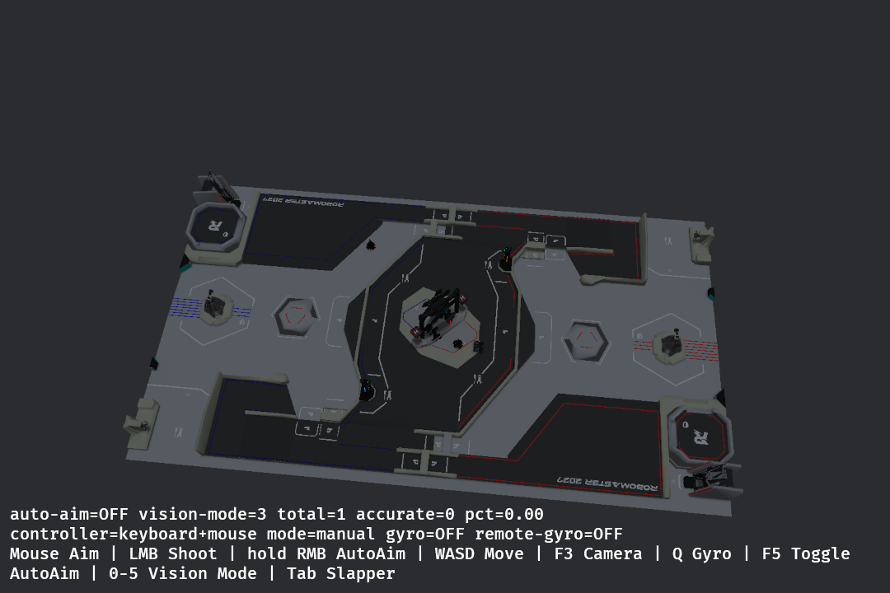

# RMUC2027 场地

默认地图已切换为 [keilking66/RMUC2027-map](https://github.com/keilking66/RMUC2027-map)
V1.0.0，来源提交 `5833356ba0595a0ddba5090dc4065f8f99e683c3`。
本次使用仓库的场地几何规格，不据此修改视觉源码或实施新的比赛裁判规则。



## 启动与配置

在工作区根目录无参数启动：

```bash
./bevy_robomaster_simulator/start_legacy_vision.sh
```

`config.toml` 的 `[scene]` 中 `map = "rmuc2027"` 选择新地图；改成 `"legacy"`
并重启可使用旧场地。地图和额外 `scene.models` 的碰撞均在车辆生成前完成加载。
`[scene.player_start]` 保留此前保存的水平位置与朝向；新地图出生高度改为 0.36 m，
实测车辆落地后根节点高度约 0.32556 m。旧地图的原快照高度为 −0.00943226 m。
视角、拟真分划和弹道补偿 UI 继续可用；`F3` 可切换第三人称及自由视角。

## 尺寸与坐标

源 NPZ 已是米制、Z 向上，转换只改变坐标轴与原点，地形比例保持 1:1：

```text
Bevy X = CAD X
Bevy Y = CAD Z + 1.850872
Bevy Z = 1.6243434 - CAD Y
```

源资料标注名义比赛场地 28×15 m；CAD 资产整体外包围约为
28.000×16.003×3.799 m（源 X/Y/Z）。资产包含场地边缘及结构伸出部分，
不会为凑 15 m 而缩放网格。CAD 未提供的完整外围围挡也没有自行补造。
中央高地、连接路、斜坡、两侧隧道、基地与补给区等静态场地直接来自源网格。

644 个源零件中，396 个作为静态场地导入，显示约 365 万个三角面，分成 3 个 GLB。
所有源零件均有去向记录，不会同时加载同一机关的静态 CAD 与交互副本。
碰撞约 91 万个三角面，使用静态凹面三角网格，不采用会填平隧道的整体凸包。
低面数部件保持原顶点；超过 15000 面的细节使用 5 mm 顶点网格量化，
顶点最大位移约 4.34 mm，并剔除退化面。

## 交互部件的适配边界

源仓库提供静态模型，未提供与本仿真的灯光、击打和旋转控制对应的功能节点。
以下部件继续使用仿真原有交互模型，因此这些部件的网格细节并非逐面复刻新 CAD：

|部件|适配方法|
|---|---|
|能量机关 p00005–p00164|整组平移到新装配体底面与水平中心；不缩放。原始网格、符转向、转速生成及固定 R 标校正保持原样。|
|前哨站 p00174–p00259|按各自 CAD 装配体的底面和水平中心平移；保留原装甲物理尺寸与交互，整站网格细节和高度仍与新 CAD 有差异。|
|科技核心 p00165–p00166|只保留原交互组件并适配到新位置，移除旧模型自带的地形；新平台来自 CAD。|
|飞镖发射标记|移到新图正 X 侧发射架附近，保留旧射向；源 CAD 无功能性炮口标记，精确炮管位置与射向尚未标定。|

红蓝机关 `small/large` 仍在默认启动脚本顶部独立选择。地图迁移不代表已完成
2027 全套裁判规则、基地可攻击状态或新机关结构的功能验收；原有联调问题仍按根目录清单追踪。

## 重新导入

生成资源已随项目保存，日常启动不需要来源仓库、下载或 Python。
需要重新生成时，编辑 `tools/import_rmuc2027_map.py` 顶部的中文配置区，再在仿真目录执行：

```bash
python3 tools/import_rmuc2027_map.py
```

需要 Python 3 与 numpy。脚本优先使用 `.cache/rmuc2027/field_meshes.npz`，
缺失时下载官方转换仓库 v1.0.0 Release，校验 SHA-256
`ff7083cfc157c4836617b157d26213c883d40d988a6f1920e4567ec41ead1465` 后才转换。
`assets/maps/rmuc2027/import_report.json` 记录源校验、坐标转换、逐部件三角面数和交互部件适配矩阵。
更换来源或量化参数后需同步检查验收坐标和零件分组，不能直接假定新版分组编号不变。

## 验证与许可

release 构建通过；Avian 使用实际碰撞资产构建 396 个碰撞体，出生点地面、坡道高差、
双侧隧道通道及顶板射线检查通过。默认入口的 GPU 渲染、视觉供图与全部三个调试窗口开启；
10 秒全景采样约 98.45 FPS，车辆高度保持不变；最终重启后 `G` 可正常生成飞镖。
这不是长期性能、精确炮口标定或完整车辆通行验收。

```bash
python3 -m unittest discover -s tools -p test_import_rmuc2027_map.py
cargo test --release --locked --bin daedalus scene::map_tests
```

源 CAD 作者为 RoboMaster 高校赛务，转换与整理为 keilking66。
CAD 衍生场地资源遵循 CC BY-NC-SA 4.0，来源许可保存在资源目录 `LICENSE.txt`；
适配用的原交互模型与项目代码沿用本项目原有许可，不将它们归为新 CAD 作者的作品。
