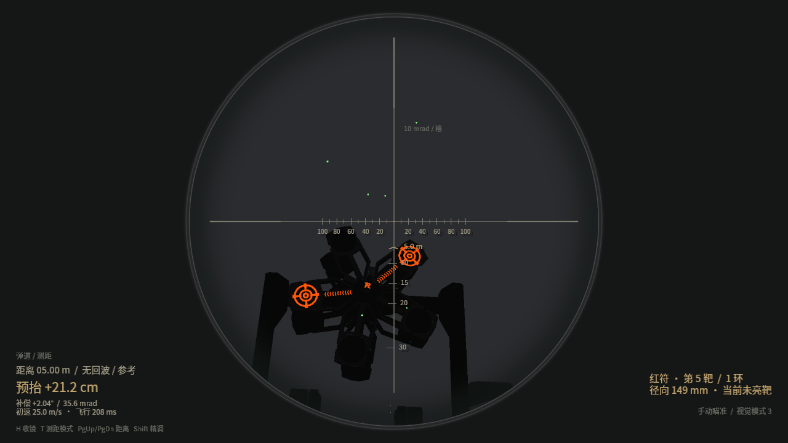

# 2027 能量机关动作与环数检测

按用户限定范围，仅模拟机关本体：旋转、灯效、受击、切靶、失败和超时重置。
没有比赛总计时、大小符阶段、激活机会、比赛积分、经验、经济或增益。
大符缩环程度由用户手动选择模拟成功 0/1/2 次，实际成功后不自动累加。
红蓝双方继续独立选择小符/大符，并自动循环用于联调。

2026-10-22 按两份 2027 V1.0.0 手册再次核对：主要旋转和击打流程已对齐，
箭头流动与大符累计进度灯效仍有差异，完整比赛机制及几何精度不能据本动作说明视为已验收。
详见 [规则核对报告](rune-rules-audit-2027.md)，问题状态统一见根目录 U19。

## 运行配置

正常运行仍从工作区根目录无参数启动：

```bash
./bevy_robomaster_simulator/start_legacy_vision.sh
```

编辑启动脚本顶部的中文配置区，修改后重启：

|配置|含义|
|---|---|
|`RED_RUNE_MODE`|红方 `small` / `large`，保留默认 `large`。|
|`BLUE_RUNE_MODE`|蓝方 `small` / `large`，保留默认 `large`。|
|`RUNE_DIRECTION`|默认 `random`，启动时抽取一次后固定；`red_cw` / `red_ccw` 可固定面对红符时的方向用于复现。蓝方观测方向相反。|

无需发起正式比赛或申请机会。每次 20 秒独立练习窗口自动开始，失败后清空本次进度并在该窗口内重试；
窗口到期后熄灯，等待 1 秒再开下一轮。成功后展示完整灯效 6 秒，再进入下一轮。
这两个练习停留时间沿用旧仿真，用于保持可持续测试，不表示比赛增益的持续时间。

编辑 `config.toml` 顶部 `[power_rune]` 的 `large_success_count`，保存后热生效：

| 设置值 | 模拟成功次数 | 大符检测范围 |
| --- | --- | --- |
| `0` | 未成功 | 1–10 环，半径 ≤150 mm |
| `1` | 成功一次 | 4–10 环，半径 ≤105 mm |
| `2` | 成功两次 | 7–10 环，半径 ≤60 mm |

这是固定手动档位，应用于红蓝两面的大符；成功、失败或重开均不修改它，小符不受影响。
缩掉的外圈仍能阻挡弹丸，但不触发命中反馈、进度或错靶失败，也不占用有效检测间隔。

## 本体动作

- 小符以及非激活中的大符为 `π/3 rad/s`。
- 激活中的大符为 `a*sin(ω*t)+(2.090-a)` rad/s，`a∈[0.780,1.045]`、`ω∈[1.884,2.000]`。
  每次进入新的激活流程重新采样并将 t 归零；同一流程切组、熄灯时不重采样。
  转角使用速度公式的解析积分，避免按当前帧速度乘帧长的累积偏差。
- 红蓝的前向法线相反，以各自正面判断方向；修正两面在同轴恒速状态下的世界旋转关系。
  双方激活状态仍独立，变速由各自当前状态决定，不强行耦合两方的独立激活流程。
- 小符随机亮 1 靶，2.5 秒内命中后完成该灯臂，再从其余未完成靶中随机选下一靶，共 5 靶。
  已激活的扇叶持续亮起，下一靶立即点亮，正常换靶不熄灯；下一靶的 2.5 秒时限从点亮时起算。
- 大符每组随机亮 2 靶，2.5 秒内首靶命中即激活该组，并保留 1 秒可选副靶窗口。
  第五组首中后仍保持副靶可击打；第二块有效命中的当下立即进入已激活，五片靶面与灯臂全亮，
  不等待剩余副靶窗口、20 秒总时限或 200 ms 换组熄灯，成功展示的 6 秒从第二中起算。
  若第五组只中首靶，仍在副靶窗口结束或第 20 秒先到时结算成功；只完成四组仍按原总窗口超时。
  每轮激活前可累计 5–10 个有效命中；成功后的碰撞沿用已激活状态的忽略语义，不额外实现正式比赛的增益结算。
- 大符仅前四组换至下一组时熄灯 200 ms。大小符错靶或首靶超时都会清空该次进度，短暂熄灯后重置，不能通过反复打错靶延长原 20 秒窗口。
- 箭头、灯臂进度、靶面亮法和材质控制均沿用此次修改前的实现。
  按用户要求回退新增的箭头动画与分段进度灯，仅大符保留换组短暂熄灯。
  原 GLB、R 标和靶标尺寸未修改。
- R 标继续常亮且固定在框架，保留此前校正的字形角度。

## 受击与十环检测

仅正常 17 mm 弹丸从靶面正面、以大于 12 m/s 的法向相对速度命中有效直径 300 mm 的圆盘时检测。
使用物理求解前路径与实际首次触盘位置；每个靶模块的有效检测间隔为 50 ms。
同一弹丸仅处理一次，42 mm 弹丸、飞镖、背面、侧面和靶区外碰撞不计。

以参考显示模型拟合的稳定靶心为基准，计算实际首次触盘位置的径向距离。十个环的边界直径依次为
30、60、90、120、150、180、210、240、270、300 mm：

|连续径向距离|环数|
|---|---|
|0–15 mm|10|
|(15,30] mm|9|
|(30,45] mm|8|
|(45,60] mm|7|
|(60,75] mm|6|
|(75,90] mm|5|
|(90,105] mm|4|
|(105,120] mm|3|
|(120,135] mm|2|
|(135,150] mm|1|

本地准镜右下显示最近一次物理检测的红/蓝方、靶编号、环数、径向距离，以及有效命中、错靶重置或未亮靶状态。
环数反馈与激活判定分开：击中未亮靶也能显示实际落环，但不能当作成功激活。
环数用于手动缩环范围判定和练习反馈，不产生比赛积分或增益。图像给视觉程序时仍不叠加准镜或环数 UI。

径向读数采用 1 mm 分辨率，并不保证整套模型/碰撞具有 1 mm 绝对精度：
原 15 mm 体素靶已由精确圆盘替代，实际资产物理回归见 U22；真实标注与视觉几何误差仍见 U01/U12。
本次没有修改视觉源码或对该误差作未经验证的校正。

## 来源与验证

依据用户提供的《RoboMaster 2027 机甲大师超级对抗赛比赛规则手册 V1.0.0（20261015）》：
4.3.2.3（纸面 54–55 页，靶面尺寸）、5.1.1（纸面 64–65 页，检测条件）、
5.6.3（纸面 97–101 页，旋转、环数示意图和切靶动作）。
高校联盟赛手册未设置能量机关，未据此添加虚构的联盟赛能量机关。

自动检查覆盖旋转积分及双面方向、流程/超时/错靶/第五组双中立即成功与漏副靶结算、小符连续亮灯与新靶时限、大符前四组副靶窗口与换组熄灯、
十环边界、真实 120 Hz/8 子步物理命中与速度/口径/正反面/径向判定。

```bash
cargo test --release --locked --bin daedalus power_rune
```

2026-10-28 按用户澄清，纠正前轮“第五组首中立即成功”的误修：第五组两块均命中才当下全亮；漏副靶保留原时限结算。本轮验收证据见根目录 U19。
2026-10-25 第五组结算/手动缩环更新后，机关相关 33 项及配置 8 项测试通过；
默认入口三档热切换、原子替换保存及替换后的再次编辑均已验证。全量测试仅 U16 原有三项失败。
2026-10-22 小符亮灯校正时，机关相关 16 项测试通过；小符覆盖连续五片亮灯与下一靶立即计时。
前次准镜控制 1 项测试及 release 构建通过；启动脚本语法与差异空白检查通过。
默认入口实际启动后，17 mm 弹丸已产生有效首靶、副靶和错靶记录，准镜显示环数及毫米读数；
字体已补齐新增中文字符。三个视觉调试窗口保持开启，视觉真实源码未修改。
原灯效控制文件与修改前逐字节一致，固定 R 标的校正变换也已对照确认。


